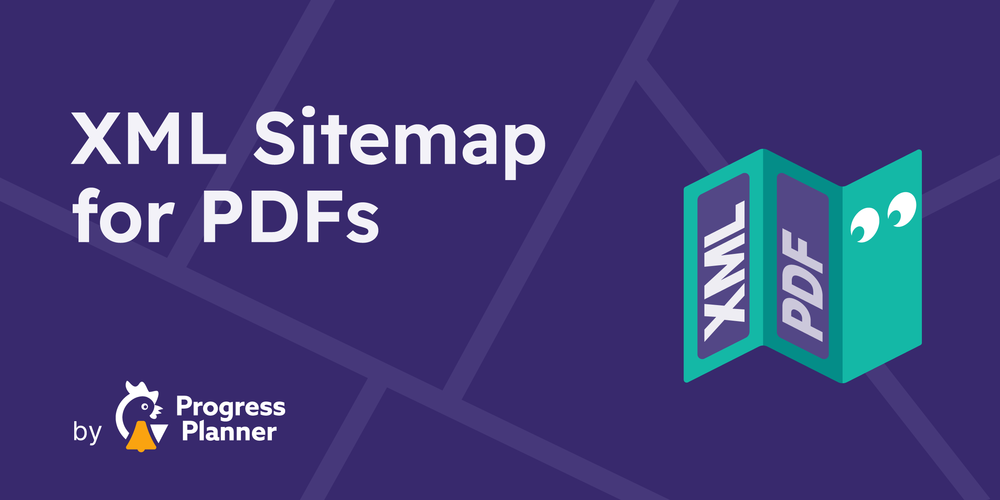

# XML Sitemap for PDFs for Yoast SEO

Automatically add PDF files from your WordPress uploads directory to Yoast SEO's XML sitemap index, so search engines can discover and crawl them more easily.

This plugin is built for sites that publish PDFs such as whitepapers, menus, manuals, brochures, research papers, or downloadable resources and want those files surfaced more reliably in search.

## Why use this plugin?

- **Makes PDFs easier to discover** by adding them to a dedicated XML sitemap.
- **Works with Yoast SEO** and adds the PDF sitemap to `sitemap_index.xml` automatically.
- **No setup required** after activation.
- **Optimized for performance** with cached sitemap generation and automatic cache clearing when new PDFs are uploaded.
- **Developer-friendly** with filters for file types, cache duration, and sitemap entries.

## How it works

After activation, the plugin:

1. scans the WordPress uploads directory for supported files;
2. generates a dedicated `pdf_files-sitemap.xml` sitemap;
3. adds that sitemap to Yoast SEO's sitemap index;
4. refreshes cached data automatically when a new PDF is uploaded.

The plugin only works when **Yoast SEO** is active.

## Installation

### Install from WordPress admin

1. Go to **Plugins → Add New**.
2. Search for **XML Sitemap for PDFs for Yoast SEO**.
3. Click **Install Now** and then **Activate**.

### Install manually

1. Download the latest release from [WordPress.org](https://wordpress.org/plugins/pdf-sitemap/) or this repository.
2. Upload the plugin to `/wp-content/plugins/pdf-sitemap/`.
3. Activate the plugin in **Plugins**.

## Usage

There are no settings.

Once activated, visit your site's `sitemap_index.xml` and you should see a link to `pdf_files-sitemap.xml`.

## Requirements

- WordPress 6.7 or higher
- PHP 7.4 or higher
- [Yoast SEO](https://yoast.com/wordpress/plugins/seo/)

## FAQ

### Will this include PDFs uploaded through forms?

Not always. The plugin scans WordPress-style numeric uploads folders, so PDFs stored outside that structure may not be included.

### Does it support other SEO plugins?

No. This plugin is built specifically for Yoast SEO.

### Does it cache sitemap output?

Yes. The plugin scans the uploads folder once per day and stores the discovered files in a transient. When a new PDF is uploaded, that cache is cleared automatically.

### Does it work on multisite?

Multisite support has not been officially tested yet.

## Filters

The plugin includes a few filters for advanced use cases:

| Filter | Description |
| --- | --- |
| `JoostBlog\WP\pdf_sitemap\filetypes` | Filter which file extensions are included. Defaults to `pdf`. |
| `JoostBlog\WP\pdf_sitemap\cache_time` | Filter cache duration in seconds. Defaults to one day. |
| `JoostBlog\WP\pdf_sitemap\pdfs` | Filter the final list of files before output. |

## Support and reporting issues

- General support: [WordPress.org support forum](https://wordpress.org/support/plugin/pdf-sitemap/)
- Bugs and enhancements: [GitHub issues](https://github.com/ProgressPlanner/pdf-xml-sitemap/issues)
- Security reports: [Patchstack vulnerability disclosure program](https://patchstack.com/database/vdp/pdf-sitemap)

## Screenshots

### PDF sitemap example

### Sitemap index example

## Changelog

### 1.1

- Fixed a bug that caused the cache not to be used.
- Fixed a bug that caused image dimensions to be missing.

### 1.0.1

- Fixed a potential notice for an unset variable.
- Renamed some filters for consistency.

### 1.0

- First release.

## License

GPL-3.0-or-later. See [LICENSE](LICENSE).
